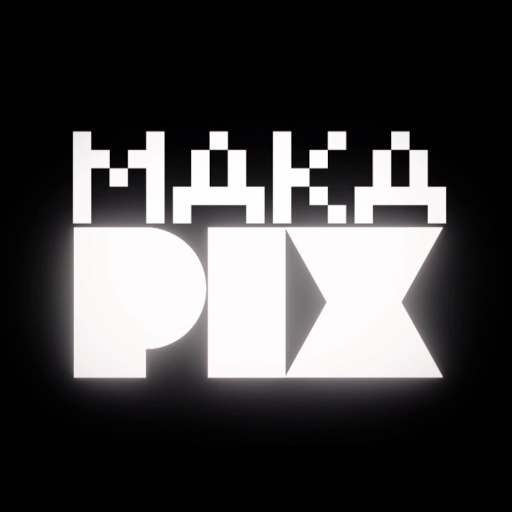

  

# Makapix Club

A home for pixel art, on your screen and on displays you build yourself.

Makapix Club connects pixel artists, art lovers, and **DIY makers**: people who build or customize their own devices. Share still images and animations, discover artists, and bring their work to a connected pixel art display. You can enjoy the community with just a browser; building hardware is optional.

**[Explore the art](https://makapix.club/recommended)** · **[Get started](docs/getting-started.md)** · **[Build a player](docs/player/README.md)** · **[Join Discord](https://discord.gg/xk9umcujXV)**

## Art from the community

A selection from the [Promoted feed](https://makapix.club/recommended), called **Recommended** on the website. Select an artwork to visit its original post.

<table>
<tr>
<td align="center" width="25%"> <a href="https://makapix.club/p/aKB7">Jellyfish glow</a> by <a href="https://makapix.club/u/XWK">Badguy</a></td>
<td align="center" width="25%"> <a href="https://makapix.club/p/pCn3">ｄｅｕｃｅｓ</a> by <a href="https://makapix.club/u/CH">m o n s t e r</a></td>
<td align="center" width="25%"> <a href="https://makapix.club/p/d9e">Metal Sonic</a> by <a href="https://makapix.club/u/zE">Odio</a></td>
<td align="center" width="25%"> <a href="https://makapix.club/p/HqL9">senna fixed</a> by <a href="https://makapix.club/u/QVJ">birds</a></td>
</tr>
</table>

<!-- Selected from /api/feed/promoted on 2026-10-27. Keep titles, artist credits,
     and post links together when refreshing this selection. Images stay hosted
     by Makapix Club; they are not copied into this repository. -->

Artwork belongs to its respective creators. See each post for its details and any license information.

## Find your starting point

| I want to… | Start here |
|------------|------------|
| Browse art or share my first piece | [Artist and visitor guide](docs/getting-started.md) |
| Build a connected display | [Player Device Guide](docs/player/README.md) |
| Try the player API on my computer | [Runnable HTTPS example](docs/player/https-connection.md#reference-example-start-here) |
| Contribute to the code | [Development Guide](docs/development.md) |
| Integrate an app or device | [HTTP API](docs/http-api/README.md) and [MQTT API](docs/mqtt-api/README.md) |

## What you can do

- **Share pixel art:** upload PNG, GIF, WebP, or BMP, including animations in supported formats. Canvases can be up to 256 × 256 pixels, with [specific rules for smaller sizes](docs/getting-started.md#prepare-your-artwork).
- **Discover artists:** explore recent and promoted artwork, follow artists, and leave emoji reactions and comments.
- **Build a player:** connect a DIY display using HTTPS or MQTT. Filter artwork to match your display's dimensions, supported formats, animation capabilities, and memory.
- **Control a connected display:** MQTT adds commands from the web interface and live online/offline status.

## For DIY makers

A **player** is a device that fetches and displays art from Makapix Club. An ESP32, Raspberry Pi, or another networked platform can become a player if it can make secure connections and decode the images you select.

1. Provision the device to receive a six-character registration code.
2. Enter that code on your Makapix Club profile's **Manage Players** page.
3. Save the device credentials and connect using HTTPS, MQTT, or both.
4. Query artwork, download the image files, and display them.

Start with the [player quick start](docs/player/quickstart.md), or explore [existing player projects](https://makapix.club/players).

## Inside the project

| Component | Technology |
|-----------|------------|
| Backend | FastAPI, Python |
| Frontend | Next.js, TypeScript, React |
| Database | PostgreSQL |
| Cache and task broker | Separate Redis instances |
| Player messaging | Mosquitto MQTT |
| Background tasks | Celery |
| Reverse proxy | Caddy |
| Artwork storage | Local vault with hash-based sharding |

See the [architecture](docs/architecture.md) for service relationships, the [development guide](docs/development.md) for local setup, and the [documentation index](docs/README.md) for all guides and references.

## Community and support

- [Discord](https://discord.gg/xk9umcujXV): questions, feedback, and community projects.
- [GitHub issues](https://github.com/fabkury/makapix/issues): reproducible bugs and feature requests.
- [License](LICENSE): source-code license; artwork has its own ownership and licensing.
