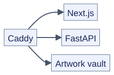
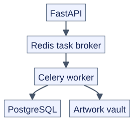
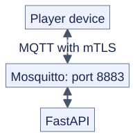

# Architecture

System architecture and component overview.

## Overview

Makapix Club is a monolithic application designed to run on a single VPS. All services are containerized with Docker Compose and communicate over internal networks.

### Web traffic



[Diagram source](assets/diagrams/web-routing.mmd)

### Data and background jobs



[Diagram source](assets/diagrams/background-jobs.mmd)

The API also reads and writes PostgreSQL directly and uses a separate Redis cache.
The frontend calls the API for application data.

### Player messaging



[Diagram source](assets/diagrams/player-messaging.mmd)

Caddy serves web traffic and artwork downloads. Native MQTT players connect directly to Mosquitto; HTTPS players use the API through Caddy. The cache and Celery task broker are separate Redis services.

## Services

### Caddy (Reverse Proxy)

Auto-discovers containers via Docker labels and handles:

- TLS termination (automatic Let's Encrypt certificates)
- Request routing by domain
- Static file serving for the vault

| Port | Protocol |
|------|----------|
| 80 | HTTP (redirects to HTTPS) |
| 443 | HTTPS |

### Web (Next.js)

React-based frontend serving the user interface.

| Aspect | Detail |
|--------|--------|
| Framework | Next.js 14 |
| Language | TypeScript |
| Port | 3000 (internal) |

### API (FastAPI)

Python backend handling all business logic.

| Aspect | Detail |
|--------|--------|
| Framework | FastAPI |
| Language | Python 3.12+ |
| ORM | SQLAlchemy 2.0+ |
| Port | 8000 (internal) |

Key modules:

| Module | Purpose |
|--------|---------|
| `routers/` | HTTP endpoint modules |
| `services/` | Business logic services |
| `mqtt/` | Player communication |
| `models.py` | Database models |
| `schemas.py` | Pydantic validation |
| `vault.py` | Image storage |
| `auth.py` | JWT + OAuth |

### Worker (Celery)

Background task processor for async operations.

| Aspect | Detail |
|--------|--------|
| Framework | Celery |
| Broker | Redis |
| Port | None (internal) |

Tasks:

- Email notifications
- Image processing
- Periodic cleanup

### DB (PostgreSQL)

Primary data store for all application data.

| Aspect | Detail |
|--------|--------|
| Version | PostgreSQL 17 |
| Port | 5432 (internal) |

### Cache (Redis)

In-memory application cache. Celery uses a separate Redis service named `broker`, with a `noeviction` policy so cache eviction cannot discard queued tasks.

| Aspect | Detail |
|--------|--------|
| Version | Redis 7 |
| Memory | 256 MB (LRU eviction) |
| Port | 6379 (internal) |

Uses:

- Database query caching
- Rate limiting state

### MQTT (Mosquitto)

Message broker for real-time player communication.

| Aspect | Detail |
|--------|--------|
| Version | Mosquitto |
| Protocol | MQTT 5.0 |
| Auth | mTLS (players), password (services) |

| Port | Protocol | Use |
|------|----------|-----|
| 1883 | MQTT | Internal services |
| 8883 (prod), 8884 (dev) | MQTTS | External players (mTLS) |

### Vault

Hash-based file storage for artwork images.

| Aspect | Detail |
|--------|--------|
| Path | `/mnt/vault-dev` (dev), `/mnt/vault-1` (prod) |
| Structure | `/{a}/{b}/{artwork_id}.{ext}` (2-level, 4,096 shards) |

Hash sharding: `a` and `b` are the low 6 bits of the first two bytes of
SHA-256(artwork_id), hex-rendered (`00`–`3f`). The stored
`posts.storage_shard` is the source of truth for every path; treat it as
opaque. Legacy 3-level paths (`/{h1}/{h2}/{h3}/…`, first 6 hex chars of the
hash) remain served from twin copies during the resharding dual window
(`docs/vault-resharding/`).

## Networks

The Compose stack separates backend traffic from services reachable by Caddy:

| Network | Members and purpose |
|---------|---------------------|
| `caddy_net` | Caddy, web, API, MQTT, and edge Redis; shared between environments |
| `internal` | Database, application cache, task broker, API, MQTT, and worker; separate per environment |

The vault is storage mounted into services, not a separate application container. See the [Compose configuration](../deploy/stack/docker-compose.yml) and environment overlays for exact network and volume assignments.

## Data Flow

| Operation | Flow |
|-----------|------|
| Web page | Browser → Caddy → Next.js; data requests reach the API |
| API request | Client → Caddy → API → database/cache |
| HTTPS player query | Player → Caddy → API → database/cache |
| MQTT player query or command | Player ↔ Mosquitto ↔ API |
| Artwork download | Player or browser → Caddy → vault file |
| Background task | API → Redis task broker → Celery worker → database or external service |

## Authentication

### Web Users

JWT-based authentication with refresh tokens stored in HTTP-only cookies.

```
Login → API validates credentials
      → Returns access token (60 min default) + refresh token (30 days)
      → Access token in response body
      → Refresh token in HTTP-only cookie
```

### Players

Players use mTLS certificates for MQTT or a device bearer token for HTTPS. The same registration flow issues both credentials:

1. Device provisions and receives a player key and registration code.
2. Owner signs in and enters the code to link the player.
3. Device retrieves and saves its certificates and HTTPS token.
4. Device connects using either transport or both.

See [Device Registration](player/registration.md) for polling, credential storage, and renewal.

## Storage

### Database Schema

Key tables:

| Table | Purpose |
|-------|---------|
| `user` | User accounts |
| `post` | Artwork and playlists |
| `reaction` | Emoji reactions |
| `comment` | Comments on posts |
| `follow` | User follows |
| `player` | Physical devices |
| `playlist` | Curated collections |
| `playset` | Device configurations |

### Vault Structure

An example current path is:

```text
/mnt/vault-1/21/32/{artwork_id}.png
```

Use the stored `storage_shard` rather than deriving paths in clients. Its depth may change, and legacy paths may differ. Players should prefer the returned `art_url`; see [Fetching Images](player/displaying-artwork.md#fetching-images).

## Environments

| Environment | Directory | Branch | Domain |
|-------------|-----------|--------|--------|
| Production | `/opt/makapix` | `main` | makapix.club |
| Development | `/opt/makapix-dev` | `develop` | development.makapix.club |

Both environments share:

- Caddy instance (routes by domain)
- Caddy certificates and config
- External network (`caddy_net`)

Separate resources:

- Database volumes
- Vault directories
- Redis instances

## Scalability

Current architecture is optimized for single-server deployment. Scaling considerations:

| Component | Horizontal Scaling |
|-----------|-------------------|
| Web | Load balancer + multiple instances |
| API | Load balancer + multiple instances |
| Worker | Multiple worker instances |
| DB | Read replicas |
| Cache | Redis cluster |
| MQTT | MQTT bridge/cluster |
| Vault | Object storage (S3-compatible) |

## Security

### Network Isolation

- Database only accessible from internal network
- API validates all requests
- MQTT requires authentication

### TLS

- All external traffic over HTTPS (Caddy auto-TLS)
- Player MQTT connections use mTLS
- Internal services use plain connections (isolated network)

### Rate Limiting

- API endpoints rate-limited by IP and user
- Redis-backed rate limiting state
- Per-endpoint configurable limits

See [Security Operations](security/operations.md) for details.
