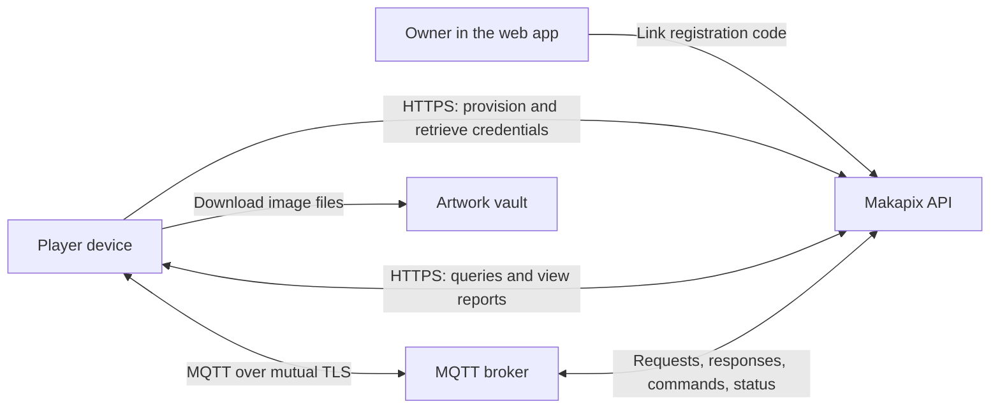

# Player Device Guide

A guide for DIY makers building displays that fetch pixel art from Makapix Club. You can try the protocol on a computer before choosing hardware.

**Start here:** [Run the HTTPS example](https-connection.md#reference-example-start-here) or follow the [four-step quick start](quickstart.md). If you only need to link an existing device, see the [artist and visitor guide](../getting-started.md#bring-art-to-a-display).

## What is a Player?

A player is any physical device that displays pixel art from the Makapix community. Players connect using **HTTPS** (individual web requests) or **MQTT** (a persistent messaging connection). They can:

- Query and display artwork from the community feed
- Filter artwork by dimensions, format, color count, and more
- React to artwork with emoji on behalf of the device owner
- Report view events
- Receive real-time commands and report live presence *(MQTT only)*

## Choosing a Transport

A **transport** is the connection used to exchange requests and responses. Both options support the same artwork queries, reactions, comment retrieval, playsets, and view reporting.

| Capability | HTTPS | MQTT |
|------------|-------|------|
| Connection | Individual requests on port 443 | Persistent connection on port 8883 |
| Device authentication | Bearer token | Mutual TLS (mTLS) client certificate |
| Queries and view reporting | Yes | Yes |
| Commands pushed from the web app | No | Yes |
| Live online/offline status | No | Yes |

Choose **HTTPS** for a simple request/response implementation or when your network blocks port 8883. Choose **MQTT** when you want web-based remote control and live presence. You can also use MQTT for commands and HTTPS for queries on the same registered device.

A bearer token is a secret sent with each HTTPS request. With mTLS, the server and device use certificates to authenticate the connection. Both credentials are issued through the same registration flow.

## Supported Platforms

Players can run on any hardware that supports:

- **Either transport:** MQTT over TLS (port 8883) **or** HTTPS (port 443)
- **Image decoding** for the formats you request (PNG, GIF, WebP, or BMP)
- **Pixel display** (LED matrix, LCD, e-ink, etc.)

Common platforms include:

| Platform | Notes |
|----------|-------|
| ESP32 | 4+ MB flash recommended for TLS |
| Raspberry Pi | Any model with network connectivity |
| Arduino | With WiFi/Ethernet and TLS library |
| Windows, Linux, or macOS | Run the Python HTTPS example for development and testing |

## Quick Links

1. **[Quick Start](quickstart.md)** - Get a device connected in minimal steps
2. **[Registration](registration.md)** - Provisioning, account linking, and credentials
3. **[MQTT Connection](mqtt-connection.md)** - mTLS setup and topic subscriptions
4. **[HTTPS Connection](https-connection.md)** - Bearer-token requests over HTTPS
5. **[Querying Artwork](querying-artwork.md)** - Fetch posts with filtering (either transport)
6. **[Displaying Artwork](displaying-artwork.md)** - Image handling and animation
7. **[Reporting](reporting.md)** - View events, reactions, comments, playsets

## Architecture Overview

1. The device provisions over HTTPS and receives a registration code.
2. The owner enters the code in the web app to link the device to their account.
3. The device retrieves its TLS certificates and HTTPS bearer token, and saves them securely.
4. It queries artwork over HTTPS or MQTT, then downloads images from the vault using the returned `art_url`.

MQTT additionally carries remote commands and live presence. HTTPS requests use `https://makapix.club/api/player/rpc` for queries and `https://makapix.club/api/player/events/view` for view reports.

## Limits and Quotas

These are the default server limits. See [HTTPS rate limits](https-connection.md#rate-limits) for per-operation request quotas.

| Resource | Limit |
|----------|-------|
| Players per user | 128 |
| Registration code validity | 15 minutes |
| Certificate validity | 1095 days (3 years) |
| Credential requests | 30/minute/IP |
| Commands per player | 300/minute |
| Commands per user | 1,000/minute |
| View events per player | 1 per 5 seconds |

## Example Implementations

- **HTTPS quickstart script:** [`scripts/test_https_player_api.py`](../../scripts/test_https_player_api.py): a runnable, dependency-free Python example of the full HTTPS flow (provision → token → query → download). The fastest way to see a working connection; see [HTTPS Connection → Reference example](https-connection.md#reference-example-start-here).
- **[p3a](https://github.com/fabkury/p3a)** - ESP32-based player with a 720x720 24-bit IPS screen (reference implementation)
- [Player projects](https://makapix.club/players) and [Discord](https://discord.gg/xk9umcujXV) for more devices and community help
